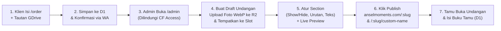
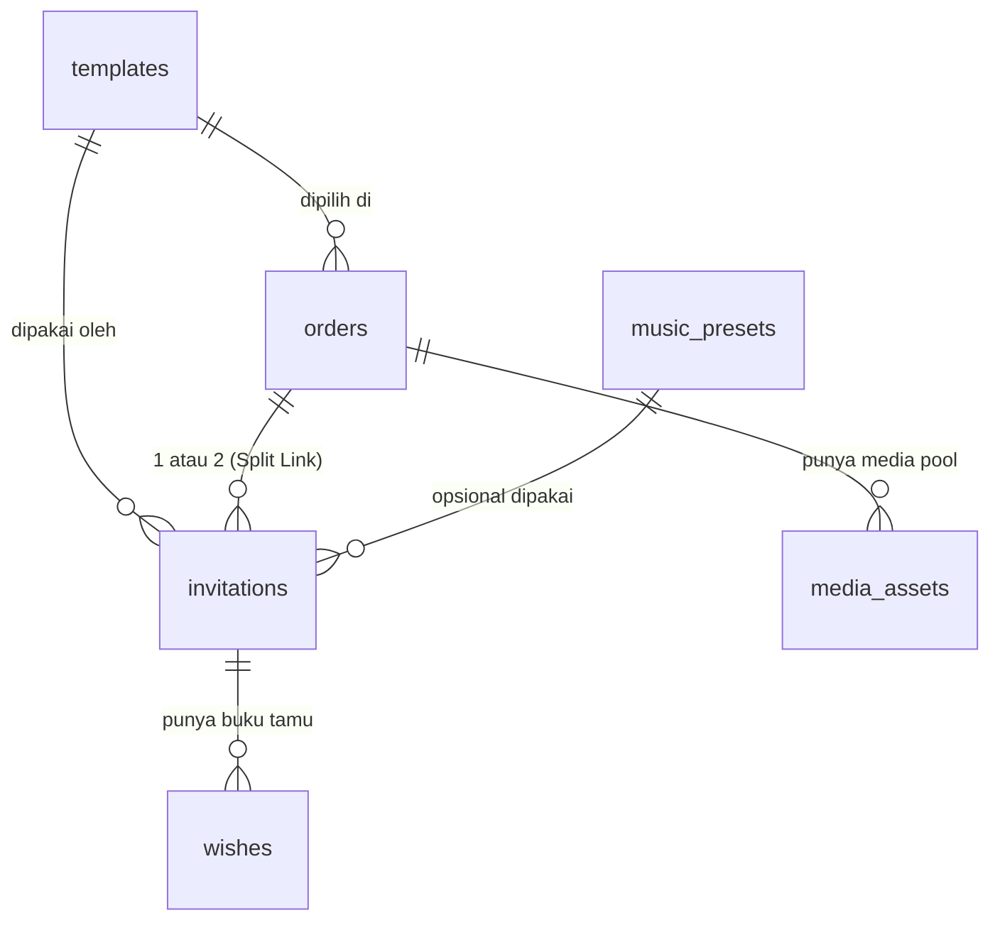

# Ringkasan Blueprint Arsitektur: Sistem Undangan Digital Dinamis (Full Cloudflare)

- **Proyek:** Ansel Moments (`anselmoments.com`)
- **Tanggal:** 22 November 2026
- **Status:** Draft Brainstorming & Review Kelengkapan

Dokumen ini merangkum seluruh keputusan arsitektur, alur bisnis, skema database, simulasi biaya/kapasitas, dan daftar hal yang masih perlu dilengkapi sebelum masuk ke pembuatan PRD final dan implementasi Fase 2.

---

## 1. Kondisi Saat Ini vs Target

- **Kondisi Sekarang (Fase 1 — Selesai di branch `feat/order-undangan`):**
  - Undangan masih statis (`/adi-eva`, `/custom-name`) dengan buku tamu di Firestore REST API.
  - Formulir pemesanan 6 langkah (`/order`) dan pelacakan status (`/order/:orderCode`) sudah aktif dengan UI minimalis referensi `lovree.com`, skema **Free**, penyimpanan sementara di Firebase Firestore, dan konfirmasi lewat WhatsApp Admin (`+6285700848786`).
- **Target Sistem Dinamis (Fase 2+):**
  - Pelanggan memesan lewat `/order` dan menyerahkan tautan Google Drive foto.
  - Admin mengelola order, menempatkan foto/audio ke slot template, menyalakan/menyembunyikan section per klien (`true`/`false`), mengecek *live preview*, lalu **Publish** ke `anselmoments.com/:slug` **tanpa coding dan tanpa deploy ulang**.

---

## 2. Stack Infrastruktur Terpilih (Full Cloudflare)

| Lapisan | Teknologi | Peran & Alasan Utama |
| --- | --- | --- |
| **Frontend** | React 18 + Vite 6 + Tailwind CSS v4 | UI halaman order, template undangan modular, dan Admin Panel. |
| **Backend API & Edge** | **Cloudflare Workers + Hono** (`worker/index.js`, `wrangler.jsonc`) | Menyatu di 1 repo & 1 deploy (`run_worker_first: ["/api/*"]`), static assets gratis unlimited, mendukung `HTMLRewriter` untuk preview WhatsApp dinamis per slug. |
| **Database Relasional** | **Cloudflare D1 (SQLite)** | 500 MB/DB gratis tanpa CC, 5 juta read/hari & 100 ribu write/hari, **tidak pernah *auto-pause***, backup *Time Travel* 7 hari gratis, akses sangat cepat langsung dari Worker (`env.DB`). |
| **Storage Foto & Audio** | **Cloudflare R2** | 10 GB storage + 10 juta Class B read/bulan gratis, **bandwidth/egress Rp 0 (unlimited)**, dihubungkan ke custom domain (`media.anselmoments.com`) dengan cache CDN. |
| **Login Admin** | **Cloudflare Access (Zero Trust)** | Gratis s/d 50 user; memblokir akses tak berizin di edge Cloudflare untuk `/admin*` & `/api/admin*` (login Google / Email OTP), ditambah verifikasi JWT `Cf-Access-Jwt-Assertion` di Worker. |
| **Pengumpulan Foto Klien** | **Google Drive** *(link dari klien)* | Hanya sebagai jalur pengiriman foto mentah klien & arsip internal — **tidak** dipakai untuk hosting `` / `<audio src>` langsung di undangan. |

---

## 3. Alur Bisnis End-to-End



---

## 4. Cara Kerja Template & Section Dinamis

- **Pola:** *Code Templates + Backend Slot Registry*.
  - Desain visual setiap tema tetap ditulis sebagai komponen React terpecah per section (`src/templates/<theme-id>/`) agar animasi, lightbox, musik, countdown, dan responsif HP tetap optimal serta aman dari XSS.
  - Database D1 menyimpan katalog tema, status `visible` (`true`/`false`), urutan section, isi teks, dan URL foto/audio R2 per klien.
- **Contoh Struktur `sections_json` per Undangan:**
  ```json
  [
    { "id": "sec-cover",  "type": "cover",      "visible": true,  "data": { "slides": ["https://media.anselmoments.com/..."] } },
    { "id": "sec-quote",  "type": "quote",      "visible": true,  "data": { "quoteText": "...", "greetingTitle": "OM SWASTYASTU" } },
    { "id": "sec-couple", "type": "couple",     "visible": true,  "data": { "groom": { "...": "..." }, "bride": { "...": "..." } } },
    { "id": "sec-mep",    "type": "mepandes",   "visible": false, "data": { "participants": [] } },
    { "id": "sec-events", "type": "events",     "visible": true,  "data": { "items": [] } },
    { "id": "sec-story",  "type": "love_story", "visible": false, "data": { "stories": [] } },
    { "id": "sec-gal",    "type": "gallery",    "visible": true,  "data": { "videoUrl": "", "photos": [] } },
    { "id": "sec-gb",     "type": "guestbook",  "visible": true,  "data": {} },
    { "id": "sec-gift",   "type": "gift",       "visible": true,  "data": { "accounts": [] } },
    { "id": "sec-footer", "type": "footer",     "visible": true,  "data": { "bgUrl": "..." } }
  ]
  ```
- **Kemampuan di Admin Panel:**
  1. Toggle **Show / Hide** setiap section per klien tanpa menghapus isinya.
  2. **Tambah / Hapus** section opsional (mis. *Mepandes*, *Love Story*, *Dresscode*, *Live Streaming*, *Custom Note*).
  3. **Geser urutan** section sesuai permintaan klien.
  4. **Sinkron otomatis dari `/order`**: opsi `hasMepandes`, `loveStoryEnabled`, `digitalGiftEnabled` langsung menyetel kondisi awal section saat draft dibuat.
  5. **Media Pool per Order/Undangan**: upload foto massal 1× (auto-kompres WebP max 1600px di browser → R2), lalu klik pilih untuk menempatkan ke berbagai slot tanpa upload ulang foto yang sama.

---

## 5. Skema Database Relasional (Cloudflare D1 — 6 Tabel)



1. **`templates`**: `id`, `name`, `tag`, `description`, `preview_image_url`, `demo_slug`, `default_sections_json`, `is_active`, `sort_order`.
2. **`orders`**: `id`, `order_code` (UNIQUE), `status`, `template_id`, `package_id`, `event_type`, `has_mepandes`, `has_split_link`, `allow_social_media`, `requested_slug`, `customer_name`, `whatsapp`, `photo_drive_url`, `music_url`, `video_url`, `notes`, `form_payload_json`, `created_at`, `updated_at`.
3. **`invitations`**: `id`, `order_id` (nullable), `slug` (UNIQUE), `template_id`, `status` (`draft`/`preview`/`published`/`archived`), `title`, `event_datetime`, `music_url`, `music_preset_id`, `share_template`, `og_title`, `og_description`, `og_image_url`, `sections_json`, `published_at`, `expires_at`.
4. **`media_assets`**: `id`, `order_id`, `invitation_id`, `r2_key` (UNIQUE), `public_url`, `asset_type` (`image`/`audio`), `mime_type`, `size_bytes`, `width`, `height`.
5. **`wishes`**: `id`, `invitation_id`, `guest_name`, `message`, `attendance`, `is_hidden` (moderasi spam), `created_at`.
6. **`music_presets`**: `id`, `title`, `artist`, `category`, `r2_key`, `public_url`, `is_active`.

---

## 6. Gambaran Endpoint API (`worker/index.js` — Hono)

### Endpoint Publik
- `GET /api/templates` — daftar tema aktif untuk `/order`
- `POST /api/orders` — submit pesanan baru dari `/order`
- `GET /api/orders/:orderCode` — cek status & ringkasan pesanan di `/order/:orderCode`
- `GET /api/invitations/:slug` — ambil data lengkap undangan yang berstatus `published` (atau `preview` dengan token)
- `GET /api/invitations/:slug/wishes` & `POST /api/invitations/:slug/wishes` — baca & kirim ucapan buku tamu
- `GET /:slug` *(HTMLRewriter)* — menyuntikkan `<title>`, `og:title`, `og:description`, dan `og:image` dinamis untuk preview WhatsApp sebelum mengembalikan `index.html`

### Endpoint Admin *(Wajib Lolos Cloudflare Access + Verifikasi JWT)*
- `GET /api/admin/orders`, `PATCH /api/admin/orders/:id` — daftar order & ubah status
- `POST /api/admin/orders/:id/convert` — konversi order menjadi 1 (atau 2 untuk Split Link) draft `invitations`
- `GET /api/admin/invitations`, `GET/PATCH/DELETE /api/admin/invitations/:id` — edit section, teks, slug, OG tags, publish/archive
- `POST /api/admin/media/upload` & `DELETE /api/admin/media/:id` — upload file ke R2 & hapus file R2
- `GET/PATCH/DELETE /api/admin/wishes/:id` — moderasi (`is_hidden`) atau hapus ucapan spam
- `CRUD /api/admin/templates` & `CRUD /api/admin/music-presets` — kelola katalog tema & koleksi lagu preset

---

## 7. Ringkasan Kapasitas & Biaya (Simulasi R2 & D1)

### Temuan Aset Aktual di Repo Sekarang
- Aset aktif 1 undangan (`AdiEvaInvitation.jsx`): **32 file = 18,61 MB** (31 foto + 1 MP3).
- File tidak terpakai di `public/`: **6 file = 6,29 MB** (`backsound.mp3`, 4 foto `Pepotrek-*.jpg`, `logo-ansel.svg`).

### Simulasi Cloudflare R2 — 100 Website (32–72 MB, Total 5,13 GB) × 1.000× Akses/Web

| Komponen Billing R2 | Pemakaian (100 Web × 1.000× Akses) | Kuota Gratis / Bulan | % Terpakai | Biaya |
| --- | --- | --- | ---: | ---: |
| **Storage** *(3.900 file)* | **5,13 GB** | 10 GB | **51,3%** | **Rp 0** |
| **Class A** *(upload awal)* | **3.900 operasi** | 1.000.000 | **0,39%** | **Rp 0** |
| **Class B** *(100.000 kunjungan, tanpa cache)* | **4.200.000 operasi** | 10.000.000 | **42%** | **Rp 0** |
| **Bandwidth / Egress** | **5,13 TB** | **Unlimited** | **0%** | **Rp 0** |
| **Total Tagihan** | — | — | — | **\$0 (Rp 0)** |

- **Storage R2** baru mulai berbayar setelah >10 GB (~195 web @ 51 MB, atau ~1.600 web jika kompres WebP @ 6 MB) dengan tarif **\$0.015/GB/bulan (~Rp 250/GB)**.
- **D1 Free (500 MB)** cukup untuk **~10.000+ undangan** (karena hanya menyimpan teks & JSON URL, ~30–50 KB/undangan). Upgrade pertama Workers Paid hanya **\$5/bulan (~Rp 80 rb)**.
- **Catatan Aktivasi R2 di Indonesia:** Butuh kartu Visa/Mastercard atau PayPal (disarankan pakai **kartu debit virtual terpisah** seperti Jenius e-Card / Bank Jago dengan limit kecil). Kartu tidak bisa dihapus selama R2 aktif (ada masa tunggu 30 hari setelah R2 di-cancel).

---

## 8. Roadmap Implementasi Bertahap

1. **Fase 1 (Selesai):** Halaman `/order` & `/order/:orderCode` (masih via Firestore).
2. **Fase 2 — Fondasi Backend Cloudflare:** Setup `wrangler.jsonc` + `worker/index.js` (Hono) + migrasi `/order` dari Firebase ke **Cloudflare D1** + proteksi **Cloudflare Access**.
3. **Fase 3 — Engine Undangan Dinamis (`/:slug`):** Refactor tema pertama (`EditorialClassic`) menjadi section modular berbasis `sections_json`, aktifkan buku tamu D1, `/:slug/custom-name` dinamis, dan `HTMLRewriter` OG preview WhatsApp.
4. **Fase 4 — Admin Panel (`/admin`) + R2 Media Studio:** Daftar order, konversi order → draft undangan, upload massal + auto-kompres WebP ke R2, penempatan foto ke slot, toggle section `true`/`false`, *live preview*, dan tombol Publish.
5. **Fase 5 — Skala & Polish:** Tambah tema ke-2 & ke-3 (`IvoryMinimal`, `WarmSand`), fitur Split Link UI, halaman Landing Page utama di `/`, serta pembersihan aset expired.

---

## 9. Checklist: Apa yang Masih Kurang / Perlu Kamu Tentukan

Gunakan daftar ini untuk mengecek hal-hal yang belum kita kunci sebelum menulis PRD & mulai coding Fase 2:

### Produk & Fitur
- [ ] **Daftar Final Section Template:** Selain `cover`, `quote`, `couple`, `mepandes`, `pawiwahan`, `events`, `love_story`, `gallery`, `guestbook`, `gift`, `footer` — apakah butuh section ekstra seperti *Dresscode*, *Live Streaming*, *Turut Mengundang*, atau *Custom Note*?
- [ ] **Template Agama / Adat Non-Hindu:** Apakah form & default section perlu preset teks pembuka untuk **Hindu Bali (Om Swastyastu)**, **Islam (Assalamu'alaikum)**, **Kristen/Katolik**, dan **Nasional/Netral**?
- [ ] **Masa Aktif & Kebijakan Expired:** Setelah masa aktif habis (mis. 6 bulan / 1 tahun), apakah undangan otomatis jadi halaman *"Masa aktif berakhir"*, tetap bisa dibuka (*archive*), atau foto R2 dihapus otomatis/manual?
- [ ] **Link Preview Sebelum Publish:** Saat status `preview_ready`, bagaimana cara klien melihat preview sebelum publik? (Opsi: URL dengan token acak seperti `/adi-eva?preview=TOKEN` atau langsung di `/adi-eva` dengan watermark/banner preview).
- [ ] **Alur Split Link Detail:** Untuk 1 order Split Link, apakah buku tamu (`wishes`) digabung antara 2 link tersebut atau dipisah per link?
- [ ] **Fitur Buku Tamu & RSVP:** Apakah butuh kolom **jumlah tamu hadir (mis. 1–5 orang)** dan tombol **export daftar RSVP ke CSV/Excel** untuk klien?
- [ ] **Fitur Custom Name (`/:slug/custom-name`):** Cukup generator link + salin teks WA seperti sekarang, atau ingin klien bisa menyimpan daftar nama tamu di database?
- [x] **Kebijakan Harga ke Depan:** Harga paket & add-on disimpan di tabel `packages` di D1 (`price = 0` tampil `Free`, `price > 0` tampil `Rp...`), dihitung server-side di Worker, dan bisa diubah kapan saja lewat `/admin`.

### Teknis, Keamanan & Operasional
- [ ] **Anti-Spam Form Publik (`/order` & Buku Tamu):** Apakah akan memasang **Cloudflare Turnstile** (gratis & tanpa CC) pada endpoint `POST /api/orders` dan `POST /api/invitations/:slug/wishes` untuk mencegah spam bot?
- [ ] **Strategi Migrasi Undangan `Adi & Eva`:** Apakah `/adi-eva` dan data buku tamu `wedding-Adi-Eva` di Firestore akan dimigrasi ke D1 + R2, atau dibiarkan statis sementara sampai acara/masa aktifnya selesai?
- [ ] **Halaman Utama (`/`):** Saat sistem dinamis sudah aktif, route `/` nantinya akan diisi **Landing Page Ansel Moments** (katalog tema, portfolio, FAQ, CTA ke `/order`) — perlu disiapkan kontennya.
- [ ] **Persiapan Akun Cloudflare:**
  - Siapkan subdomain R2 (mis. `media.anselmoments.com`) di DNS Cloudflare.
  - Aktivasi R2 dengan kartu debit virtual khusus (limit kecil) bila sudah siap.
  - Catat email admin untuk whitelist **Cloudflare Access**.
- [ ] **Dokumen Pendukung Repo:** Membuat `AGENTS.md` (aturan proyek untuk AI agent) dan mem-finalkan **PRD** setelah poin-poin checklist di atas diputuskan.
