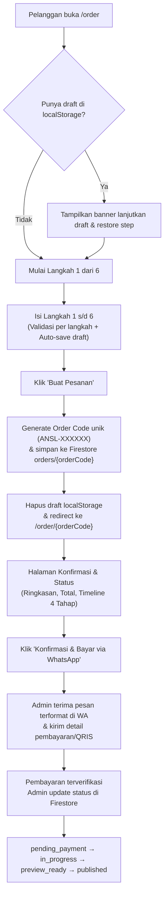

# Design Spec: Sistem Pemesanan Undangan Digital (`/order` & `/order/:orderCode`)

- **Tanggal:** 22 November 2026
- **Proyek:** Ansel Moments (`anselmoments.com`)
- **Status:** Draft untuk Review
- **Referensi Fungsional:** `https://tamubali.com/orderundangan/`
- **Referensi Desain UI:** `https://lovree.com/`

---

## 1. Tujuan & Konteks

Website undangan Ansel Moments saat ini masih bersifat statis ([AdiEvaInvitation.jsx](../../src/pages/AdiEvaInvitation.jsx) & [CustomName.jsx](../../src/pages/CustomName.jsx)) dan di-deploy sebagai React SPA di Cloudflare Pages. Sebagai fondasi tahap pertama menuju platform undangan digital yang dinamis, dibutuhkan fitur **Pemesanan Undangan Digital** dengan:

1. **Bisnis proses pelanggan yang optimal & minim hambatan (*zero-friction*)**: pendaftaran langsung tanpa login (*guest order*), penyimpanan data terstruktur ke **Firebase Firestore**, tanpa upload file, dan pembayaran diarahkan ke **WhatsApp Admin** (`+6285700848786`).
2. **Skema data siap dinamis (*dynamic-ready*)**: struktur dokumen order memisahkan metadata komersial dan `invitationData` sehingga pada fase berikutnya (renderer undangan dinamis & admin panel) data bisa langsung dipakai tanpa migrasi ulang.
3. **Antarmuka simple, minimalis, modern, dan hangat**: mengadopsi tipografi, palet warna, proporsi, dan estetika editorial `lovree.com` di atas **Tailwind CSS v4**, sekaligus mengisolasi CSS lama ([invitation.css](../../src/styles/invitation.css)) agar undangan aktif tidak berubah.

---

## 2. Bisnis Proses Optimal & Alur Pelanggan

### 2.1 Diagram Alur End-to-End



### 2.2 Aturan Bisnis Utama

1. **Tanpa Login (*Guest Order*)**: Pelanggan cukup mengisi formulir dan nomor WhatsApp aktif. Tidak ada registrasi password atau autentikasi yang menghambat konversi.
2. **Pembayaran 100% via WhatsApp Admin**:
   - Tidak ada upload bukti transfer di formulir.
   - Tidak ada nomor rekening atau QRIS yang ditampilkan di website (dikirim langsung oleh admin di WhatsApp setelah pelanggan melakukan konfirmasi).
3. **Auto-Save Draft (`localStorage`)**:
   - Key: `ansel_order_draft_v1`, berlaku selama **3 hari**.
   - Menyimpan seluruh state form + langkah aktif terakhir sehingga pelanggan aman berpindah aplikasi (Google Maps, YouTube, Google Drive) untuk menyalin tautan.
   - Tersedia tombol **"Mulai Ulang"** di banner draft jika pelanggan ingin mengosongkan formulir.
4. **Kode Pesanan & Pelacakan Mandiri**:
   - Format: `ANSL-XXXXXX` (6 karakter alfanumerik huruf kapital & angka tanpa karakter ambigu `0, O, 1, I, L`, dihasilkan via `crypto.getRandomValues`).
   - Kode pesanan menjadi Document ID di Firestore dan parameter URL `/order/:orderCode`.
   - Pada header halaman `/order`, terdapat tombol **"Cek Status Pesanan"** yang membuka modal input kode order untuk langsung melompat ke `/order/:orderCode`.
5. **Lifecycle Status Pesanan**:
   - `pending_payment` — *Menunggu Pembayaran* (status awal)
   - `in_progress` — *Sedang Dikerjakan*
   - `preview_ready` — *Siap Preview*
   - `published` — *Undangan Aktif*
   - `cancelled` — *Dibatalkan*

---

## 3. Struktur Route

Route eksisting **wajib dipertahankan** agar seluruh tautan undangan yang sudah dibagikan tidak terganggu:

| Route | Komponen | Keterangan |
| --- | --- | --- |
| `/` | `AdiEvaInvitation` | Tetap (undangan aktif saat ini) |
| `/adi-eva` | `AdiEvaInvitation` | Tetap |
| `/custom-name` | `CustomName` | Tetap |
| `/adi-eva/custom-name` | `CustomName` | Tetap |
| `/order` | `OrderPage` (**Baru**) | Wizard pemesanan 6 langkah + modal Cek Status |
| `/order/:orderCode` | `OrderStatusPage` (**Baru**) | Halaman konfirmasi, ringkasan, status, & tombol WA |
| `*` | `FallbackRedirect` | Tetap mengarah ke `/adi-eva` |

Semua halaman baru (`OrderPage`, `OrderStatusPage`) dan halaman lama dapat menggunakan `React.lazy` + `Suspense` atau import langsung yang bersih, sambil memastikan CSS tidak saling tumpang tindih.

---

## 4. Sistem Desain UI (Referensi `lovree.com`)

### 4.1 Tipografi

Tambahkan font Google Fonts di `index.html`:
- **Display & Headings (`font-ibarra`)**: `'Ibarra Real Nova', serif` (bobot `400;500;600;700`, normal & italic).
  - Ciri khas editorial: judul utama memakai teks `codGray-950` dengan 1–2 kata penekanan `italic text-goldSand-800` (contoh: `Pesan` *Undangan Digital* `Anda`).
- **Body, Form, & UI (`font-dm`)**: `'DM Sans', system-ui, sans-serif` (bobot `400;500;600;700`).

### 4.2 Palet Warna (Tailwind v4 `@theme` Tokens)

| Token | Hex | Penggunaan |
| --- | --- | --- |
| `goldSand-50` | `#fdf8ef` | Background canvas halaman & sticky header |
| `goldSand-100` | `#faefda` | Background kartu ringkasan, kartu opsi terpilih, border halus aksen |
| `goldSand-300` | `#ecc486` | Fill tombol Primary CTA (teks `codGray-900`) |
| `goldSand-400` | `#e3a254` | Hover tombol Primary CTA |
| `goldSand-500` | `#dd8932` | Highlight badge paket unggulan |
| `goldSand-800` | `#894723` | Teks italic editorial, step aktif, switch aktif, focus ring, link |
| `codGray-50` | `#f6f6f6` | Hover tombol secondary & permukaan input subtle |
| `codGray-100` | `#e7e7e7` | Hairline border kartu putih & field input |
| `codGray-500` | `#707070` | Helper text, placeholder, metadata sekunder |
| `codGray-900` | `#3d3d3d` | Teks body utama & outline tombol secondary |
| `codGray-950` | `#0a0a0a` | Heading utama & angka harga |
| `white` | `#ffffff` | Kartu formulir utama & kartu tema |

### 4.3 Prinsip Layout & Komponen

- **Header Minimalis**: Sticky bar (`bg-goldSand-50/90 backdrop-blur-sm border-b border-goldSand-100`), berisi logo Ansel Moments (`/assets/img/logo-ansel.png` + wordmark `font-ibarra`) di kiri dan tombol outline pill **"Cek Status"** di kanan.
- **Stepper 6 Langkah**:
  - Desktop: 6 step horizontal bersih dengan nomor lingkaran (`bg-goldSand-800 text-white` untuk aktif/selesai, `border-codGray-100 text-codGray-500` untuk belum), step yang sudah selesai dapat diklik untuk kembali mengedit.
  - Mobile: Header progres ringkas (`Langkah X dari 6 · [Nama Langkah]`) + bar progres 4px berwarna `goldSand-800`.
- **Grid Responsif `/order`**:
  - Desktop (`lg:grid-cols-12 gap-8 max-w-6xl mx-auto`):
    - Kolom kiri (`lg:col-span-8`): Kartu form putih (`bg-white rounded-2xl border border-codGray-100 p-6 sm:p-8`) dengan ritme spasi lapang.
    - Kolom kanan (`lg:col-span-4`): `OrderSummaryCard` sticky (`bg-goldSand-100/75 rounded-2xl border border-goldSand-100 p-6`), menampilkan nama mempelai, preview link `anselmoments.com/{slug}`, tema terpilih, rincian paket & add-on, total estimasi, dan status auto-save.
  - Mobile: 1 kolom fokus dengan *sticky bottom bar* ringan berisi total estimasi dan tombol navigasi `Kembali` / `Lanjut`.
- **Gaya Input & Kontrol**:
  - Input/textarea/select: `rounded-xl border border-codGray-100 bg-white px-4 py-3 text-codGray-900 placeholder:text-codGray-500/70 focus:border-goldSand-800 focus:outline-none focus:ring-2 focus:ring-goldSand-300/50`.
  - Kartu radio/pilihan (Izin Sosmed, Tema, Paket): `rounded-2xl border` dengan transisi state aktif `border-goldSand-800 bg-goldSand-50`.
  - Toggle switch (Love Story, Amplop Digital, Split Link): pill switch lembut berwarna `goldSand-800` saat aktif.
  - Tombol Primary: `rounded-2xl bg-goldSand-300 hover:bg-goldSand-400 text-codGray-900 font-medium px-6 py-3`.
  - Tombol Secondary: `rounded-2xl border border-codGray-900 bg-white hover:bg-codGray-50 text-codGray-900 font-medium px-6 py-3`.

### 4.4 Isolasi CSS & Integrasi Tailwind CSS v4

- Instal `tailwindcss` dan `@tailwindcss/vite`, daftarkan `tailwindcss()` di [vite.config.js](../../vite.config.js).
- Buat `src/styles/app.css` yang di-import di `src/main.jsx` berisi `@import "tailwindcss";` dan `@theme` untuk seluruh token warna dan font Lovree.
- **Isolasi [invitation.css](../../src/styles/invitation.css)**:
  - Saat ini baris 1–13 memuat `* { padding: 0; margin: 0; box-sizing: border-box; }` dan `body { font-family: 'Cormorant Garamond', serif; background-color: #000; color: #fff; }` yang akan menimpa Tailwind `@layer utilities` dan mengubah background halaman lain.
  - Bungkus return JSX di [AdiEvaInvitation.jsx](../../src/pages/AdiEvaInvitation.jsx) dengan `<div className="invitation-root">...</div>` dan ubah selector global di `invitation.css` menjadi `.invitation-root, .invitation-root * { box-sizing: border-box; }` serta pindahkan `font-family`, `background-color: #000`, `color: #fff` ke `.invitation-root` (ditambah reset margin/padding ter-scope hanya pada elemen dalam `.invitation-root` atau mempertahankan rule spesifik masing-masing class yang sudah ada). Dengan ini tampilan `/adi-eva` tetap 100% identik, sementara `/order`, `/order/:orderCode`, dan `/custom-name` bebas dari kebocoran style hitam.

---

## 5. Spesifikasi Lengkap 6 Langkah Formulir

### Langkah 1: Pengaturan Awal (`preferences`)
Banner informasi lembut: *"Saat ini formulir tersedia untuk undangan Pernikahan (termasuk opsi tambahan Metatah/Mepandes). Jenis acara lainnya akan segera hadir."*

| Field Key | Label UI | Tipe Input | Wajib | Keterangan & Validasi |
| --- | --- | --- | --- | --- |
| `eventType` | Jenis Undangan | Select | Ya | Default `"pernikahan"` (`Pernikahan`), siap dikembangkan di `orderCatalog.js` |
| `hasMepandes` | Ada tambahan acara Metatah / Mepandes? | Radio Cards (`Tidak` / `Iya`) | Ya | Default `false`. Jika `true`, membuka bagian Mepandes di Langkah 3 |
| `allowSocialMedia` | Izin tampilkan foto di sosial media Ansel Moments? | Radio Cards (`Boleh` / `Tidak boleh`) | **Ya** | Default `null` (harus dipilih). Helper: *"Foto hanya akan ditampilkan setelah acara berlangsung."* |

### Langkah 2: Pilih Tema (`theme`)
| Field Key | Label UI | Tipe Input | Wajib | Keterangan & Validasi |
| --- | --- | --- | --- | --- |
| `themeId` | Pilih Tema Undangan | Grid Kartu Tema (radio) | **Ya** | Bersumber dari `ORDER_THEMES` di `orderCatalog.js`. Setiap kartu punya gambar preview, nama tema, deskripsi singkat, badge gaya, dan link **"Lihat Demo ↗"** (`target="_blank"`). |

### Langkah 3: Data Mempelai (`couple`)
**Sub-bagian A — Mempelai Pria (`groom`)**
| Field Key | Label UI | Tipe Input | Wajib | Placeholder / Helper |
| --- | --- | --- | --- | --- |
| `groom.fullName` | Nama Lengkap Pria | Text | **Ya** | `I Gede Adi Wijaya` |
| `groom.nickname` | Nama Panggilan Pria | Text | **Ya** | `Adi` (dipakai untuk judul & auto-slug) |
| `groom.parentDescription` | Deskripsi Orang Tua Pria | Textarea | Opsional | `Putra pertama dari pasangan Bpk. ... & Ibu ...` |
| `groom.address` | Alamat / Asal Pria | Text | Opsional | `Denpasar, Bali` |
| `groom.instagram` | Username Instagram Pria | Text (prefix `@`) | Opsional | `anselmoments` (tanpa `@`, otomatis dibersihkan jika user mengetik `@`) |

**Sub-bagian B — Mempelai Wanita (`bride`)**
Struktur identik dengan `groom`: `fullName`*, `nickname`*, `parentDescription`, `address`, `instagram`.

**Sub-bagian C — Peserta Mepandes (`mepandes[]`, tampil hanya jika `hasMepandes === true`)**
Repeater card dengan tombol **"+ Tambah Peserta Mepandes"** (otomatis terisi 1 baris kosong saat `hasMepandes` diubah ke `true`, minimal 1 baris valid jika aktif):
- `fullName` (Text, **Wajib jika Mepandes aktif**)
- `description` (Textarea, Opsional)
- `instagram` (Text tanpa `@`, Opsional)

### Langkah 4: Rangkaian Acara (`events`)
| Field Key | Label UI | Tipe Input | Wajib | Keterangan & Validasi |
| --- | --- | --- | --- | --- |
| `primaryEventDateTime` | Tanggal & Waktu Acara Dimulai | `datetime-local` | **Ya** | Digunakan untuk countdown & cover undangan. Saat diisi, otomatis mengisi saran `dateLabel` pada acara pertama jika masih kosong. |
| `events[]` | Rangkaian Acara (Repeater, minimal 1) | Repeater Cards | **Ya** | Tombol **"+ Tambah Acara Lain"** (mis. Pawiwahan, Memadik, Resepsi) |
| `events[i].name` | Nama Acara | Text | **Ya** | Placeholder: `Pawiwahan / Resepsi / Memadik` |
| `events[i].dateLabel` | Hari & Tanggal Acara | Text | **Ya** | Placeholder: `Rabu, 19 Agustus 2026` |
| `events[i].timeLabel` | Waktu Acara | Text | **Ya** | Placeholder: `Pukul 15.00 WITA – Selesai` |
| `events[i].address` | Alamat Lokasi Acara | Textarea | **Ya** | Alamat lengkap tempat acara |
| `events[i].mapsUrl` | Link Google Maps | URL / Text | Opsional | Placeholder: `https://maps.app.goo.gl/...` (validasi harus URL `http(s)://` jika diisi) |

### Langkah 5: Paket, Fitur Tambahan & Media (`featuresMedia`)
| Field Key | Label UI | Tipe Input | Wajib | Keterangan & Validasi |
| --- | --- | --- | --- | --- |
| `packageId` | Pilih Paket Undangan | Kartu Paket (radio) | **Ya** | Bersumber dari `ORDER_PACKAGES` di `orderCatalog.js` (default paket pertama/rekomendasi) |
| `features.loveStoryEnabled` | Fitur Love Story | Toggle Switch | Opsional | Mengaktifkan repeater `loveStories[]` (`title`, `description`). Saat di-ON-kan, otomatis tambah 1 baris kosong. |
| `features.digitalGiftEnabled` | Fitur Amplop Digital | Toggle Switch | Opsional | Mengaktifkan repeater `digitalGifts[]` (`bankName`, `accountHolder`, `accountNumber`). Saat di-ON-kan, otomatis tambah 1 baris kosong. |
| `addons.splitLink` | Split Link (Add-On Berbayar) | Toggle Switch | Opsional | Harga dari `ORDER_ADDONS.splitLink` (default `+Rp49.000`). Deskripsi: *"Buat 2 link undangan berbeda dari 1 pesanan (mis. tamu umum & keluarga dekat)."* |
| `media.musicUrl` | Link Musik Latar (YouTube) | URL / Text | Opsional | Placeholder: `https://www.youtube.com/watch?v=...` |
| `media.videoUrl` | Link Video Prewedding (YouTube) | URL / Text | Opsional | Placeholder: `https://www.youtube.com/watch?v=...` |
| `media.photoDriveUrl` | Tautan Folder Foto (Google Drive) | URL / Text | Opsional | Helper: *"Pastikan akses link 'Siapa saja yang memiliki link'. Foto juga dapat dikirim via WhatsApp setelah order jika belum siap."* |
| `notes` | Catatan / Request Khusus | Textarea | Opsional | Placeholder: *"Misal: request kutipan/sloka khusus, urutan nama, atau catatan lainnya..."* |

### Langkah 6: Kontak, Link Undangan & Konfirmasi (`review`)
| Field Key | Label UI | Tipe Input | Wajib | Keterangan & Validasi |
| --- | --- | --- | --- | --- |
| `requestedSlug` | Custom Link Undangan | Text dengan prefix `anselmoments.com/` | **Ya** | Otomatis terisi `slugify(groom.nickname + '-' + bride.nickname)` kecuali user sudah mengedit manual (`isSlugEdited`). Hanya huruf kecil, angka, tanda `-` (`^[a-z0-9]+(?:-[a-z0-9]+)*$`). |
| `contact.customerName` | Nama Pemesan | Text | **Ya** | Nama orang yang menghubungi & memesan (tampil di Firestore, halaman status, dan pesan WhatsApp admin) |
| `contact.whatsapp` | Nomor WhatsApp Aktif | Tel | **Ya** | Placeholder: `081234567890`. Validasi nomor HP Indonesia (10–15 digit, diawali `08` / `628` / `+628`), dinormalisasi ke `628...`. Helper: *"Kami akan menghubungi & mengirimkan info pembayaran ke nomor ini."* |
| Ringkasan Pesanan | Preview seluruh data + rincian harga | Read-only summary cards | — | Masing-masing seksi punya tombol **"Ubah"** untuk melompat kembali ke step terkait. Catatan transparan: *"Pembayaran dilakukan melalui WhatsApp Admin setelah pesanan dibuat."* |

---

## 6. Model Data Firestore & Security Rules

### 6.1 Struktur Dokumen `orders/{orderCode}`

```json
{
  "orderCode": "ANSL-7K9M2X",
  "schemaVersion": 1,
  "status": "pending_payment",
  "eventType": "pernikahan",
  "hasMepandes": false,
  "allowSocialMedia": true,
  "themeId": "editorial-classic",
  "themeName": "Editorial Classic (Adi & Eva)",
  "packageId": "premium",
  "packageName": "Premium",
  "addons": {
    "splitLink": false
  },
  "pricing": {
    "currency": "IDR",
    "basePrice": 299000,
    "addonsTotal": 0,
    "totalPrice": 299000
  },
  "requestedSlug": "adi-eva",
  "publishedSlug": null,
  "contact": {
    "customerName": "Adi & Eva",
    "whatsapp": "6281234567890"
  },
  "invitationData": {
    "groom": {
      "fullName": "I Gede Adi Wijaya",
      "nickname": "Adi",
      "parentDescription": "Putra pertama dari pasangan Bpk. I Nyoman Sukra & Ibu Ni Wayan Darsih",
      "address": "Link Gadon GG Manggis No 4",
      "instagram": ""
    },
    "bride": {
      "fullName": "Putu Eva Cahyani",
      "nickname": "Eva",
      "parentDescription": "Putri pertama dari pasangan Bpk. I Nyoman Kertiyasa & Ibu Dewa Ayu Citrawati",
      "address": "Sesetan, Denpasar Selatan",
      "instagram": ""
    },
    "mepandes": [],
    "primaryEventDateTime": "2026-08-19T15:00",
    "events": [
      {
        "name": "Pawiwahan",
        "dateLabel": "Rabu, 19 Agustus 2026",
        "timeLabel": "15.00 WITA – Selesai",
        "address": "Jalan Raya Gadon, Gg Manggis No 4",
        "mapsUrl": "https://maps.app.goo.gl/hG8v8ggMFQ8XfUv5A"
      }
    ],
    "features": {
      "loveStoryEnabled": false,
      "digitalGiftEnabled": true
    },
    "loveStories": [],
    "digitalGifts": [
      {
        "bankName": "Bank BNI",
        "accountHolder": "I Gede Adi Wijaya",
        "accountNumber": "0700899045"
      }
    ],
    "media": {
      "musicUrl": "",
      "videoUrl": "",
      "photoDriveUrl": ""
    },
    "notes": ""
  },
  "createdAt": "<Firestore serverTimestamp>",
  "updatedAt": "<Firestore serverTimestamp>"
}
```

### 6.2 Rekomendasi Firestore Security Rules

Disimpan sebagai dokumentasi referensi di `firestore.rules` (untuk diterapkan oleh pemilik proyek di Firebase Console):

```firestore
rules_version = '2';
service cloud.firestore {
  match /databases/{database}/documents {
    // Tetap dukung buku tamu eksisting
    match /wedding-Adi-Eva/{wishId} {
      allow read, create: if true;
    }

    // Koleksi pesanan baru
    match /orders/{orderCode} {
      // Hanya bisa dibaca jika mengetahui orderCode persis (mencegah list/scrape)
      allow get: if true;
      allow list, update, delete: if false;

      // Validasi dasar saat pelanggan membuat pesanan
      allow create: if request.resource.data.orderCode == orderCode
        && request.resource.data.status == 'pending_payment'
        && request.resource.data.schemaVersion == 1
        && request.resource.data.contact.whatsapp is string
        && request.resource.data.contact.whatsapp.size() >= 10
        && request.resource.data.pricing.totalPrice is number
        && request.resource.data.pricing.totalPrice >= 0
        && request.resource.data.requestedSlug is string
        && request.resource.data.requestedSlug.size() >= 2;
    }
  }
}
```

### 6.3 Template Pesan WhatsApp Admin (`/order/:orderCode`)

Saat pelanggan menekan **"Konfirmasi & Bayar via WhatsApp"** (mengarah ke `https://wa.me/6285700848786?text=...`):

```text
Halo Admin Ansel Moments, saya sudah mengisi formulir pemesanan undangan digital.

*Detail Pesanan:*
• Kode Order: ANSL-7K9M2X
• Mempelai: Adi & Eva
• Tema: Editorial Classic (Adi & Eva)
• Paket: Premium (Rp299.000)
• Add-On: Split Link (+Rp49.000) [tampil jika dipilih]
• Total Estimasi: *Rp348.000*
• Request Link: anselmoments.com/adi-eva

Link status pesanan:
https://anselmoments.com/order/ANSL-7K9M2X

Mohon informasi metode pembayaran untuk melanjutkan proses pengerjaan ya. Terima kasih!
```

---

## 7. Arsitektur File & Batasan Modul

Setiap file memiliki satu tanggung jawab jelas:

```text
.env.example                           # Template env VITE_FIREBASE_*
firestore.rules                        # Referensi Firestore Security Rules
index.html                             # Tambah Google Fonts: Ibarra Real Nova & DM Sans
vite.config.js                         # Tambah @tailwindcss/vite plugin
src/
├── styles/
│   ├── app.css                        # @import "tailwindcss"; + @theme Lovree tokens
│   └── invitation.css                 # Scope global reset ke .invitation-root
├── config/
│   └── orderCatalog.js                # Katalog tema, paket, add-on, WA admin, status metadata
├── lib/
│   └── firebase.js                    # Inisialisasi Firebase App & Firestore instance
├── utils/
│   ├── orderHelpers.js                # Pure logic: orderCode, slugify, WA normalize, pricing, step validation, WA URL
│   └── orderHelpers.test.js           # Unit test Vitest untuk seluruh pure logic
├── services/
│   └── orderService.js                # createOrder & getOrderByCode (Firestore SDK)
├── hooks/
│   └── useOrderDraft.js               # State form + auto-save/restore localStorage (TTL 3 hari)
├── components/
│   └── order/
│       ├── OrderLayout.jsx            # Sticky header (logo + Cek Status), canvas goldSand-50, footer
│       ├── CheckOrderModal.jsx        # Modal pencarian kode pesanan → navigate /order/:code
│       ├── StepProgress.jsx           # Indikator 6 langkah (desktop stepper + mobile bar)
│       ├── OrderSummaryCard.jsx       # Sticky ringkasan real-time (desktop) & mobile summary bar
│       ├── Step1Preferences.jsx       # Jenis acara, Mepandes, Izin Sosmed
│       ├── Step2Theme.jsx             # Grid pilihan tema + link demo
│       ├── Step3Couple.jsx            # Data Mempelai Pria, Wanita, & repeater Mepandes
│       ├── Step4Events.jsx            # Tanggal utama & repeater Rangkaian Acara
│       ├── Step5FeaturesMedia.jsx     # Paket, Love Story, Amplop Digital, Split Link, Media, Catatan
│       └── Step6ReviewContact.jsx     # Custom slug, Kontak WA, Ringkasan lengkap + tombol Ubah
└── pages/
    ├── OrderPage.jsx                  # Orchestrator wizard /order
    └── OrderStatusPage.jsx            # Halaman konfirmasi & pelacakan /order/:orderCode
```

---

## 8. Penanganan Error & Edge Cases

1. **Firebase Env Belum Dikonfigurasi**: `src/lib/firebase.js` memvalidasi kelengkapan `VITE_FIREBASE_*` saat dipanggil dan menampilkan pesan ramah di UI saat submit/fetch (tidak menyebabkan crash layar putih di awal render).
2. **Gagal Koneksi / Timeout saat Submit**: Tombol submit dinonaktifkan selama proses (`isSubmitting`) untuk mencegah double-order. Jika Firestore gagal, tampilkan alert error yang jelas dan **jangan hapus draft** di `localStorage` agar pelanggan bisa klik coba lagi tanpa mengetik ulang.
3. **Navigasi Langsung ke `/order/:orderCode` Tidak Valid**: Normalisasi uppercase + trim pada kode; jika dokumen tidak ditemukan, tampilkan state kosong yang rapi dengan form pencarian kode lain dan tombol kembali ke `/order`.
4. **Refresh Setelah Submit**: Karena data dibaca langsung dari Firestore di `OrderStatusPage`, pelanggan bisa menyalin link `/order/ANSL-XXXXXX`, membukanya di perangkat lain, atau membukanya lagi besok untuk mengecek update status dari admin.
5. **Toggle Fitur Dimatikan Lalu Dinyalakan Lagi**: Saat `loveStoryEnabled` / `digitalGiftEnabled` / `hasMepandes` dimatikan, data repeater yang tidak aktif tidak ikut divalidasi dan disanitasi menjadi array kosong `[]` pada payload final saat submit agar data Firestore tetap bersih.

---

## 9. Strategi Verifikasi & Testing

1. **Unit Tests (`Vitest`)** pada `src/utils/orderHelpers.test.js`:
   - Format & keunikan `generateOrderCode` (`^ANSL-[A-HJ-NP-Z2-9]{6}$`).
   - `generateSlug` (spasi, simbol, huruf besar, karakter beraksen, fallback kosong).
   - `normalizeWhatsapp` (`08...`, `+628...`, spasi/tanda hubung, penolakan nomor tidak valid).
   - `calculateOrderPricing` (harga paket dasar, dengan/tanpa Split Link).
   - `validateStep` untuk setiap langkah 1–6 (termasuk conditional Mepandes, Love Story, Amplop Digital, URL validation).
   - `buildAdminWhatsappUrl` (format pesan & encoding URL).
2. **Build & Lint Verification**: `npm run build` dan `npm test` lulus tanpa error.
3. **Verifikasi Visual & Fungsional Manual**:
   - Cek `/adi-eva` dan `/custom-name` tetap 100% identik tanpa regresi CSS.
   - Uji alur penuh `/order` di viewport desktop & mobile (draft auto-save, navigasi antar step, validasi, submit ke Firestore, redirect `/order/:orderCode`, modal Cek Status, dan link WhatsApp).
